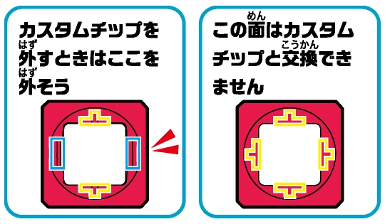

# PLAKORO FAQ

## ワザカードについて about skill cards

#### 1

|   Q   | ラッキーのワザ「チャンスタックル」のキャラコロ効果で、次の番、自分が振るキャラコロを振りなおせることになりました。 この場合、キャラコロを1度も振りなおさないことはできますか？ |
| :---: | :-------------------------------------------------------------------------------------------------------------------------------------------------------------------------------- |
|   A   | はい、できます。                                                                                                                                                                  |
|   R   | チャンスタックル                                                                                                                                                                  |

#### 2

|   Q   | ラッキーのワザ「チャンスタックル」のキャラコロ効果で、次の番、自分が振るキャラコロを2回振りなおせることになりました。 1回振りなおしたあと、2回目は振りなおさないことはできますか？ |
| :---: | :------------------------------------------------------------------------------------------------------------------------------------------------------------------------------------ |
|   A   | はい、できます。                                                                                                                                                                      |
|   R   | チャンスタックル                                                                                                                                                                      |

#### 3

|   Q   | ラッキーのワザ「チャンスタックル」のキャラコロ効果で、次の番、自分が振るキャラコロを振りなおせることになりました。 次の相手の番、ゲンガーのワザ「まっさかさま」のキャラコロ効果を受けました。 次の番、最初に振ったキャラコロと振りなおしたキャラコロの向きはそれぞれどうなりますか？ |
| :---: | :----------------------------------------------------------------------------------------------------------------------------------------------------------------------------------------------------------------------------------------------------------------------------------------- |
|   A   | この番に振るキャラコロの向きがすべて{hs}になるので、振りなおしても{hs}になります。                                                                                                                                                                                                         |
|   R   | チャンスタックル, まっさかさま                                                                                                                                                                                                                                                             |

#### 4

|   Q   | ヤミラミのワザ「そそのかす」のエネコロチェックとキャラコロチェックに成功しました。 次の相手の番、相手が使うワザを自分が選ぶ時、前の相⼿の番に相⼿が使ったワザを選んで使わせることはできますか？ |
| :---: | :----------------------------------------------------------------------------------------------------------------------------------------------------------------------------------------------- |
|   A   | いいえ、できません。                                                                                                                                                                             |
|   R   | そそのかす                                                                                                                                                                                       |

#### 5

|   Q   | ヤミラミのワザ「ジュエルフラッシュ」のエネコロチェックとキャラコロチェックに成功しました。 次の相⼿の番、相⼿のワザが失敗した場合でも、エネコロを2個選んで振りなおさせますか？ |
| :---: | :------------------------------------------------------------------------------------------------------------------------------------------------------------------------------ |
|   A   | はい。必ず2つ選んで振りなおさせます。                                                                                                                                           |
|   R   | ジュエルフラッシュ                                                                                                                                                              |

#### 6

|   Q   | ヤミラミのワザ「ジュエルフラッシュ」のキャラコロ効果がはたらいている時に、相手のヒトカゲのワザ「ヒートアップ」のキャラコロ効果で、次の相手の番、相手が振れるエネコロが2個多くなりました。 この場合、「次の相手の番、相手のエネコロを2個選んで振りなおさせる。」はどのように行いますか？                                                                                               |
| :---: | :--------------------------------------------------------------------------------------------------------------------------------------------------------------------------------------------------------------------------------------------------------------------------------------------------------------------------------------------------------------------------------------- |
|   A   | エネコロが3個しかない場合は最初に振った3個のエネコロの中から2個を選んで、振りなおさせます。 その後、キャラコロ効果で増えた分のエネコロをもう一度振ります。 振りなおさせた分を含む3個と、キャラコロ効果で増えた分の2個で出たエネルギーがすべて、この番に出たエネルギーになります。 別のエネコロを追加して同時に振る場合は、その中から好きなエネコロを2個選んで振りなおさせます。 |
|   R   | ジュエルフラッシュ, ヒートアップ                                                                                                                                                                                                                                                                                                                                                         |

#### 7

|   Q   | ボスゴドラのワザ「タイラントシールド」のキャラコロ効果がはたらいている時に、相手のミュウのワザ「サイコショット」のエネコロチェックとキャラコロチェックが成功して、50ダメージを受けることになりました。 この場合、この番に自分が受けるダメージは何ダメージですか？ |
| :---: | :------------------------------------------------------------------------------------------------------------------------------------------------------------------------------------------------------------------------------------------------------------------- |
|   A   | 50ダメージです。 相手からのダメージが40以下の場合はダメージを受けませんが、50以上のダメージはそのまま受けます。                                                                                                                                                   |
|   R   | タイラントシールド                                                                                                                                                                                                                                                   |

#### 8

|   Q   | ボスゴドラのワザ「タイラントシールド」のキャラコロ効果がはたらいている時に、相手のルカリオのワザ「オーラづき」で、30ダメージを受けることになりました。 この場合、この番に自分が受けるダメージは何ダメージですか？ |
| :---: | :------------------------------------------------------------------------------------------------------------------------------------------------------------------------------------------------------------------- |
|   A   | 50ダメージです。 ボスゴドラの弱点は闘なので、受けるダメージは30＋20＝50ダメージになります。 その場合、この番に受けるダメージは50以上となるため、ワザのダメージはそのまま受けます。                             |
|   R   | タイラントシールド, オーラづき                                                                                                                                                                                       |

#### 9

|   Q   | 相⼿がワザに失敗した次の番、ボスゴドラのワザ「パワフルスチール」のエネコロチェックとキャラコロチェックに成功しました。 この場合、相手に与えるダメージは何ダメージですか？ |
| :---: | :-------------------------------------------------------------------------------------------------------------------------------------------------------------------------- |
|   A   | 60ダメージです。 ワザ成功の20ダメージに加えて、前の相手の番、ボスゴドラがワザのダメージを受けていないため、40ダメージを追加することができます。                          |
|   R   | パワフルスチール                                                                                                                                                            |

#### 10

|   Q   | 先攻初回の番、ボスゴドラのワザ「パワフルスチール」のエネコロチェックとキャラコロチェックに成功しました。 この場合、キャラコロ効果でダメージを追加することはできますか？ |
| :---: | :------------------------------------------------------------------------------------------------------------------------------------------------------------------------- |
|   A   | いいえ、できません。 まだ相手が番を行っていないので、ダメージを追加することはできません。                                                                               |
|   R   | パワフルスチール                                                                                                                                                           |

#### 11

|   Q   | レックウザのワザ「げきりんランページ」を選びました。 エネコロチェックは{R}{L}、{R}{L}、{R}{L}、キャラコロチェックは{hs}でした。 この場合、相手に与えるダメージは何ダメージですか？                    |
| :---: | :---------------------------------------------------------------------------------------------------------------------------------------------------------------------------------------------------------- |
|   A   | 60ダメージです。 ワザに必要なエネコスト{R}{R}{R}{L}{L}ぶんのエネルギーが出ているため、エネコロチェックは成功となります。 キャラコロチェックは失敗のため、相手に60ダメージを与えて番は終了となります。 |
|   R   | げきりんランページ                                                                                                                                                                                          |

#### 12

|   Q   | レックウザのワザ「ドラゴンバースト」を選びました。 エネコロチェックは{R}{L}、{R}{L}、{R}{L}、キャラコロチェックは立ちでした。 この場合、相手に与えるダメージは何ダメージですか？                      |
| :---: | :---------------------------------------------------------------------------------------------------------------------------------------------------------------------------------------------------------- |
|   A   | 70ダメージです。 エネコロチェックが成功したぶんの10ダメージに、「ドラゴンバースト」のキャラコロ効果によって「エネコロで出た{L}エネルギーの数×20ダメージ」を追加できるため、20×3=60ダメージを追加します。 |
|   R   | ドラゴンバースト                                                                                                                                                                                            |

#### 13

|   Q   | 「へんげぎり」のキャラコロ効果に成功した場合、つけ替えるカスタムチップはどのように準備すればよいですか？ |
| :---: | :------------------------------------------------------------------------------------------------------- |
|   A   | 対戦準備の時に⽤意しておきます。（相⼿に⾒せる必要はありません。）                                          |
|   R   | へんげぎり                                                                                               |

#### 14

|   Q   | ゲッコウガのワザ「へんげぎり」のキャラコロ効果で、自分のエネコロのカスタムチップをつけ替えられることになりました。 カスタムチップを1枚もつけ替えないことはできますか？ |
| :---: | :------------------------------------------------------------------------------------------------------------------------------------------------------------------------ |
|   A   | はい、できます。 その場合は、つけ替えないことを相⼿に伝えて番を終わります。                                                                                             |
|   R   | へんげぎり                                                                                                                                                                |

#### 15

|   Q   | ゲッコウガのワザ「へんげぎり」のキャラコロ効果で、自分のエネコロのカスタムチップをつけ替えられることになりました。 カスタムチップをつけ替えるのではなく、⾃分が持っている別のエネコロを選んで交換することは出来ますか？ |
| :---: | :------------------------------------------------------------------------------------------------------------------------------------------------------------------------------------------------------------------------ |
|   A   | いいえ、できません。交換できるのはカスタムチップのみです。                                                                                                                                                                |
|   R   | へんげぎり                                                                                                                                                                                                                |

#### 16

|   Q   | カヌチャンのワザ「ハンマーストライク」のキャラコロ効果で、次の自分の番、自分が振れるエネコロが2個少なくなりました。 さらに、次の相手の番、相手のルカリオのワザ「はっけい」のキャラコロ効果で、次の自分の番、自分が振れるエネコロが1個少なくなりました。 この場合、次の番に自分が振れるエネコロは何個ですか？ |
| :---: | :----------------------------------------------------------------------------------------------------------------------------------------------------------------------------------------------------------------------------------------------------------------------------------------------------------------- |
|   A   | 0個です。 振れるエネコロが0個の番も、この番に使うワザを選択して、キャラコロだけを振ってください。 結果が出たら、この番は終了となります。                                                                                                                                                                     |
|   R   | ハンマーストライク, はっけい                                                                                                                                                                                                                                                                                       |

#### 17

|   Q   | ゲンガーのワザ「まっさかさま」のエネコロチェックとキャラコロチェックに成功しました。 「次の相手の番、相手のキャラコロの向きを{hs}にする。」とはどのように行いますか？ |
| :---: | :----------------------------------------------------------------------------------------------------------------------------------------------------------------------- |
|   A   | 次の相⼿の番、相⼿はキャラコロを振った後、{hs}にします。 これにより、相手が次の番に複数回キャラコロを振る場合でも、すべてのキャラコロの向きが{hs}になります。           |
|   R   | まっさかさま                                                                                                                                                             |

#### 18

|   Q   | ゲンガーのワザ「まっさかさま」のエネコロチェックとキャラコロチェックに成功しました。 次の相⼿の番、相⼿がサンダーのワザ「ダブルサンダー」のエネコロチェックとキャラコロチェックを成功させました。 この場合、次の番に相手が振るキャラコロの向きはどうなりますか？ |
| :---: | :------------------------------------------------------------------------------------------------------------------------------------------------------------------------------------------------------------------------------------------------------------------- |
|   A   | 次の番、相⼿が振るキャラコロの向きはすべて{hs}になります。 これにより、「ダブルサンダー」キャラコロチェックはすべて失敗となります。                                                                                                                                |
|   R   | まっさかさま, ダブルサンダー                                                                                                                                                                                                                                         |

#### 19

|   Q   | メタグロスのワザ「しそくえんざん」のエネコロチェックに成功して、キャラコロで立ちが出ました。 次の相⼿の番、相手がゲンガーのワザ「まっさかさま」のエネコロチェックとキャラコロチェックを成功させました。 この場合、次の番に相手が振るキャラコロの向きはどうなりますか？ |
| :---: | :-------------------------------------------------------------------------------------------------------------------------------------------------------------------------------------------------------------------------------------------------------------------------- |
|   A   | 「まっさかさま」のキャラコロ効果で、キャラコロの向きは{hs}になります。                                                                                                                                                                                                      |
|   R   | しそくえんざん, まっさかさま                                                                                                                                                                                                                                                |

#### 20

|   Q   | メタグロスのワザ「しそくえんざん」のエネコロチェックに成功して、キャラコロで立ちが出ました。 次の相⼿の番、相手がゲンガーのワザ「かげしばり」のエネコロチェックとキャラコロチェックを成功させました。 この場合、次の番に自分が振るキャラコロの向きはどうなりますか？ |
| :---: | :------------------------------------------------------------------------------------------------------------------------------------------------------------------------------------------------------------------------------------------------------------------------ |
|   A   | 「かげしばり」のキャラコロ効果で、キャラコロを振れなくなります。                                                                                                                                                                                                          |
|   R   | しそくえんざん, かげしばり                                                                                                                                                                                                                                                |

#### 21

|   Q   | メタグロスのワザ「だいばくはつ」のワザ効果で、⾃分もダメージを受けて、おたがいのポケモンのHPが同時になくなりました。 この場合、勝敗はどうなりますか？ |
| :---: | :------------------------------------------------------------------------------------------------------------------------------------------------------ |
|   A   | 自分の負けです。 同時にHPがなくなった場合、ワザを使った⽅が負けになります。                                                                           |
|   R   | だいばくはつ                                                                                                                                            |

#### 22

|   Q   | ルカリオのHPが120の時に、ルカリオのワザ「はどうナックル」のエネコロチェックとキャラコロチェックに成功しました。 この場合、ダメージを追加することはできますか？ |
| :---: | :---------------------------------------------------------------------------------------------------------------------------------------------------------------- |
|   A   | いいえ、できません。 「はどうナックル」のキャラコロ効果でダメージを追加できるのは、HPが80以下のときだけです。                                                  |
|   R   | はどうナックル                                                                                                                                                    |

#### 23

|   Q   | ベトベターのワザ「どくガス」を使いました。 エネコロチェックは成功、キャラコロチェックは失敗でした。 次の自分の番、ベトベターのワザ「どくどくボンバー」のエネコロチェックとキャラコロチェックに成功した場合、ダメージを追加することはできますか？ |
| :---: | :----------------------------------------------------------------------------------------------------------------------------------------------------------------------------------------------------------------------------------------------------- |
|   A   | はい、できます。                                                                                                                                                                                                                                       |
|   R   | どくガス, どくどくボンバー                                                                                                                                                                                                                             |

#### 24

|   Q   | 相手がピカチュウのワザ「エレキラッシュ」を使いました。 1回目のエネコロチェックとキャラコロチェックは成功、2回目のエネコロチェックは失敗でした。 次の自分の番、ベトベターのワザ「いやがらせベノム」のエネコロチェックとキャラコロチェックに成功した場合、ダメージを追加することはできますか？ |
| :---: | :------------------------------------------------------------------------------------------------------------------------------------------------------------------------------------------------------------------------------------------------------------------------------------------------- |
|   A   | はい、できます。                                                                                                                                                                                                                                                                                   |
|   R   | いやがらせベノム, エレキラッシュ                                                                                                                                                                                                                                                                   |

#### 25

|   Q   | イワークのワザ「ロックウォール」のエネコロチェックとキャラコロチェックに成功しました。 次の相手の番、相手がピカチュウのワザ「エレキラッシュ」を2回成功させました。 この場合、自分が受けるダメージは何ダメージですか？ |
| :---: | :-------------------------------------------------------------------------------------------------------------------------------------------------------------------------------------------------------------------------- |
|   A   | 0ダメージです。 ワザを1回受けるたびに、受けるダメージを-30することができます。                                                                                                                                           |
|   R   | ロックウォール, エレキラッシュ                                                                                                                                                                                              |

#### 26

|   Q   | イワークのワザ「ロックウォール」のエネコロチェックとキャラコロチェックに成功しました。 次の相手の番、相手がサンダーのワザ「ボルトラッシュ」のキャラコロチェックを2回成功させました。 この場合、自分が受けるダメージは何ダメージですか？ |
| :---: | :-------------------------------------------------------------------------------------------------------------------------------------------------------------------------------------------------------------------------------------------- |
|   A   | 40ダメージです。 「ボルトラッシュ」の合計ダメージから、受けるダメージを-30することができます。                                                                                                                                             |
|   R   | ロックウォール, ボルトラッシュ                                                                                                                                                                                                                |

#### 27

|   Q   | カイロスのワザ「チャージばさみ」のエネコロチェックとキャラコロチェックに成功しました。 「次の自分の番、自分のエネコロを1個多くする。」とはどのように行いますか？ また、多くするエネコロを選ぶのは誰ですか？                                                                                      |
| :---: | :----------------------------------------------------------------------------------------------------------------------------------------------------------------------------------------------------------------------------------------------------------------------------------------------------- |
|   A   | 3個エネコロを振った後に、その中から好きな1個を選んでもう⼀度振ります。 その間に出たエネルギーがすべて、この番に出たエネルギーになります。 エネコロを4つ以上持っている場合は、好きなエネコロを追加して、同時に振っても良いです。 多くするエネコロをどれにするかは、エネコロを振る人が選びます。 |
|   R   | チャージばさみ                                                                                                                                                                                                                                                                                         |

#### 28

|   Q   | カイロスのワザ「ハサミギロチン」を使いました。 エネコロチェックは草エネルギー4つ、キャラコロチェックは{st}でした。 この場合、ダメージを与えることはできますか？ |
| :---: | :-------------------------------------------------------------------------------------------------------------------------------------------------------------------- |
|   A   | いいえ、できません。 エネコロチェックに失敗しているため、ワザは失敗となります。 その場合、キャラコロチェックは行わず、番は終了となります。                      |
|   R   | ハサミギロチン                                                                                                                                                        |

#### 29

|   Q   | フリーザーのワザ「アイスウイング」のキャラコロ効果で、次の相手の番、相手が振れるエネコロが1個少なくなりました。 少なくするエネコロを選ぶのは誰ですか？ |
| :---: | :-------------------------------------------------------------------------------------------------------------------------------------------------------- |
|   A   | 相手です。 少なくするエネコロをどれにするかは、エネコロを振る人が選びます。                                                                            |
|   R   | アイスウイング                                                                                                                                            |

#### 30

|   Q   | ヒトカゲのワザ「ヒートアップ」のキャラコロ効果で、次の自分の番、自分が振れるエネコロが2個多くなりました。 ただし、相手のフリーザーのワザ「コールドブレス」のキャラコロ効果で、次の自分の番、自分が振れるエネコロが2個少なくなりました。 この場合、次の番に自分が振れるエネコロは何個ですか？ |
| :---: | :------------------------------------------------------------------------------------------------------------------------------------------------------------------------------------------------------------------------------------------------------------------------------------------------- |
|   A   | 3個です。                                                                                                                                                                                                                                                                                          |
|   R   | コールドブレス, ヒートアップ                                                                                                                                                                                                                                                                       |

#### 31

|   Q   | サンダーのワザ「サンダーチェイン」のエネコロチェックとキャラコロチェックに成功しました。 「もう1回キャラコロを振る。（失敗するまで繰り返せる。）」とはどのように行いますか？ |
| :---: | :------------------------------------------------------------------------------------------------------------------------------------------------------------------------------ |
|   A   | {st}{ba}{do}以外が出るまで、キャラコロを振ります。 {st}{ba}{do}が出た回数×30ダメージを追加して、相⼿のポケモンにダメージを与えます。                                          |
|   R   | サンダーチェイン                                                                                                                                                                |

#### 32

|   Q   | ファイヤーのワザ「ほのおのつばさ」のキャラコロ効果で、⾃分もダメージを受けて、おたがいのポケモンのHPが同時になくなりました。 この場合、勝敗はどうなりますか？ |
| :---: | :-------------------------------------------------------------------------------------------------------------------------------------------------------------- |
|   A   | 自分の負けです。 同時にHPがなくなった場合、ワザを使った⽅が負けになります。                                                                                   |
|   R   | ほのおのつばさ                                                                                                                                                  |

#### 33

|   Q   | フシギダネのワザ「やどりぎのタネ」のエネコロチェックとキャラコロチェックに成功しました。 「次の自分の番、自分のエネコロを1個多くする。」とはどのように行いますか？                                                                                                                                                                  |
| :---: | :------------------------------------------------------------------------------------------------------------------------------------------------------------------------------------------------------------------------------------------------------------------------------------------------------------------------------------- |
|   A   | まずは3個エネコロを振ります。 次に、振り終えたエネコロの中から好きな1個を選び、もう⼀度振ります。 多くするエネコロをどれにするかは、エネコロを振る人が選びます。 その間に出たエネルギーがすべて、この番に出たエネルギーになります。 もしエネコロを4つ以上持っているなら、好きなエネコロを追加して、同時に振っても良いです。 |
|   R   | やどりぎのタネ                                                                                                                                                                                                                                                                                                                         |

#### 34

|   Q   | フシギダネのHPが120の時に、フシギダネのワザ「ギガドレイン」のエネコロチェックとキャラコロチェックに成功しました。 この場合、HPを160にすることはできますか？ |
| :---: | :------------------------------------------------------------------------------------------------------------------------------------------------------------- |
|   A   | いいえ、できません。フシギダネの最⼤HPは120です。                                                                                                               |
|   R   | ギガドレイン                                                                                                                                                   |

#### 35

|   Q   | フシギダネのワザ「とつげき」のキャラコロ効果で、⾃分もダメージを受けて、おたがいのポケモンのHPが同時になくなりました。 この場合、勝敗はどうなりますか？ |
| :---: | :-------------------------------------------------------------------------------------------------------------------------------------------------------- |
|   A   | 自分の負けです。 同時にHPがなくなった場合、ワザを使った⽅が負けになります。                                                                             |
|   R   | とつげき                                                                                                                                                  |

#### 36

|   Q   | ヒトカゲのワザ「ヒートアップ」のエネコロチェックとキャラコロチェックに成功しました。 「次の自分の番、自分のエネコロを2個多くする。」とはどのように行いますか？ また、多くするエネコロを選ぶのは誰ですか？                                                                                                                            |
| :---: | :----------------------------------------------------------------------------------------------------------------------------------------------------------------------------------------------------------------------------------------------------------------------------------------------------------------------------------------- |
|   A   | まずは3個エネコロを振ります。 次に、振り終えたエネコロの中から好きな2個を選び、もう⼀度振ります。 （もしエネコロを4つ以上持っているなら、好きなエネコロを追加して、同時に振っても良いです。） その間に出たエネルギーがすべて、この番に出たエネルギーになります。 多くするエネコロをどれにするかは、エネコロを振る人が選びます。 |
|   R   | ヒートアップ                                                                                                                                                                                                                                                                                                                               |

#### 37

|   Q   | ヒトカゲのワザ「フレアストーム」のエネコロチェックとキャラコロチェックに成功しました。 出た炎エネルギーは5つでした。 この場合、相手に与えるダメージは何ダメージですか？ |
| :---: | :---------------------------------------------------------------------------------------------------------------------------------------------------------------------------- |
|   A   | 70ダメージです。                                                                                                                                                              |
|   R   | フレアストーム                                                                                                                                                                |

#### 38

|   Q   | 前の自分の番にゼニガメのワザ「シェルアタック」のエネコロチェックとキャラコロチェックに成功しました。 次の相手の番、相手がフシギダネのワザ「つるのムチ」を使いました。 エネコロチェックは成功、キャラコロチェックは失敗でした。 この場合、自分が受けるダメージは何ダメージですか？ |
| :---: | :----------------------------------------------------------------------------------------------------------------------------------------------------------------------------------------------------------------------------------------------------------------------------------------- |
|   A   | 0ダメージです。                                                                                                                                                                                                                                                                            |
|   R   | シェルアタック, つるのムチ                                                                                                                                                                                                                                                                 |

#### 39

|   Q   | 前の自分の番にゼニガメのワザ「シェルアタック」のエネコロチェックとキャラコロチェックに成功しました。 次の相手の番、相手がフシギダネのワザ「つるのムチ」を使い、エネコロチェックとキャラコロチェックに成功しました。 この場合、自分が受けるダメージは何ダメージですか？ |
| :---: | :--------------------------------------------------------------------------------------------------------------------------------------------------------------------------------------------------------------------------------------------------------------------------- |
|   A   | 10ダメージです。                                                                                                                                                                                                                                                             |
|   R   | シェルアタック, つるのムチ                                                                                                                                                                                                                                                   |

#### 40

|   Q   | ピカチュウのワザ「エレキラッシュ」のエネコロチェックとキャラコロチェックに成功しました。 「もう1回「エレキラッシュ」を使う。（失敗するまでくり返せる。）」とはどのように行いますか？ |
| :---: | :-------------------------------------------------------------------------------------------------------------------------------------------------------------------------------------- |
|   A   | もう一度エネコロとキャラコロを振って、「エレキラッシュ」に挑戦します。 これをエネコロチェックかキャラコロチェックのどちらかが失敗するまで繰り返します。                              |
|   R   | エレキラッシュ                                                                                                                                                                          |

#### 41

|   Q   | ピカチュウのワザ「10まんボルト」のエネコロチェックとキャラコロチェックに成功しました。 「次の自分の番、自分のエネコロを2個少なくする。」とはどのように行いますか？ また、少なくするエネコロを選ぶのは誰ですか？ |
| :---: | :-------------------------------------------------------------------------------------------------------------------------------------------------------------------------------------------------------------------- |
|   A   | 3個のエネコロの中から、好きな1個を選んで振ります。 少なくするエネコロをどれにするかは、エネコロを振る人が選びます。                                                                                                |
|   R   | 10まんボルト                                                                                                                                                                                                          |

#### 42

|   Q   | ピカチュウのワザ「ボルテッカー」のワザ効果で、⾃分もダメージを受けて、おたがいのポケモンのHPが同時になくなりました。 この場合、勝敗はどうなりますか？ |
| :---: | :------------------------------------------------------------------------------------------------------------------------------------------------------ |
|   A   | 自分の負けです。 同時にHPがなくなった場合、ワザを使った⽅が負けになります。                                                                           |
|   R   | ボルテッカー                                                                                                                                            |

#### 43

|   Q   | 相手がフシギダネのワザ「やどりぎのタネ」のエネコロチェックとキャラコロチェックに成功して、次の自分の番、自分が振れるエネコロが1個少なくなりました。 次の自分の番、エネコロが2個の状態で、ピカチュウのワザ「エレキラッシュ」のエネコロチェックとキャラコロチェックに成功しました。 続けて2回目の「エレキラッシュ」を使う時、自分が振れるエネコロの数は何個ですか？ |
| :---: | :---------------------------------------------------------------------------------------------------------------------------------------------------------------------------------------------------------------------------------------------------------------------------------------------------------------------------------------------------------------------- |
|   A   | 2個です。 さらに成功が続いた場合も、エネコロの数は2個のままです。                                                                                                                                                                                                                                                                                                    |
|   R   | エレキラッシュ, やどりぎのタネ                                                                                                                                                                                                                                                                                                                                          |

#### 44

|   Q   | 先攻初回の番、エネコロが2個の状態で、ピカチュウのワザ「エレキラッシュ」のエネコロチェックとキャラコロチェックに成功しました。 続けて2回目の「エレキラッシュ」を使う時、自分が振れるエネコロの数は何個ですか？ |
| :---: | :--------------------------------------------------------------------------------------------------------------------------------------------------------------------------------------------------------------- |
|   A   | 2個です。 さらに成功が続いた場合も、エネコロの数は2個のままです。                                                                                                                                             |
|   R   | エレキラッシュ                                                                                                                                                                                                   |

#### 45

|   Q   | イーブイのワザ「とっしん」を使いました。 エネコロチェックは空エネルギー3つ、キャラコロチェックは{s1}でした。 この場合、相手に与えるダメージは何ダメージですか？ |
| :---: | :-------------------------------------------------------------------------------------------------------------------------------------------------------------------- |
|   A   | 30ダメージです。                                                                                                                                                      |
|   R   | とっしん                                                                                                                                                              |

#### 46

|   Q   | イーブイのワザ「ぜんりょくダッシュ」を使いました。 どのタイプのエネルギーが何個出れば成功ですか？ |
| :---: | :--------------------------------------------------------------------------------------------------- |
|   A   | どのタイプでもいいので、エネルギーが5個出ていれば成功するワザです。                                  |
|   R   | ぜんりょくダッシュ                                                                                   |

#### 47

|   Q   | イーブイのワザ「とっしん」のキャラコロ効果で、⾃分もダメージを受けて、おたがいのポケモンのHPが同時になくなりました。 この場合、勝敗はどうなりますか？ |
| :---: | :------------------------------------------------------------------------------------------------------------------------------------------------------ |
|   A   | 自分の負けです。 同時にHPがなくなった場合、ワザを使った⽅が負けになります。                                                                           |
|   R   | とっしん                                                                                                                                                |

#### 48

|   Q   | ミュウのワザ「サイコキネシス」のエネコロチェックとキャラコロチェックに成功しました。 相⼿がエネコロを振り、草エネルギーと炎エネルギーと⽔エネルギーが1個ずつ出ました。 この場合、相手に与えるダメージは何ダメージですか？ |
| :---: | :---------------------------------------------------------------------------------------------------------------------------------------------------------------------------------------------------------------------------- |
|   A   | 30ダメージです。 「一番多く出たタイプのエネルギーの数」は1個なので、1×10＝10ダメージが追加されます。                                                                                                                       |
|   R   | サイコキネシス                                                                                                                                                                                                                |

#### 49

|   Q   | 相手がピカチュウのワザ「かじる」のエネコロチェックとキャラコロチェックに成功して、自分が40ダメージを受けました。 次の自分の番、自分がミュウのワザ「リフレクション」のエネコロチェックとキャラコロチェックに成功しました。 この場合、相手に与えるダメージは何ダメージですか？ |
| :---: | :--------------------------------------------------------------------------------------------------------------------------------------------------------------------------------------------------------------------------------------------------------------------------------- |
|   A   | 20ダメージです。 「相手が最後に選んだワザに書かれているダメージ」は10ダメージです。 「リフレクション」のキャラコロ効果でその2倍を与えられるため、10×2=20ダメージとなります。                                                                                                 |
|   R   | リフレクション, かじる                                                                                                                                                                                                                                                             |

#### 50

|   Q   | 相手がピカチュウのワザ「アイアンテール」のエネコロチェックとキャラコロチェックに成功して、自分が20ダメージを受けました。 次の自分の番、自分がミュウのワザ「リフレクション」のエネコロチェックに成功しました。 この場合、相手に与えるダメージは何ダメージですか？ |
| :---: | :--------------------------------------------------------------------------------------------------------------------------------------------------------------------------------------------------------------------------------------------------------------------- |
|   A   | 10ダメージです。 「相手が最後に選んだワザに書かれているダメージ」は20ダメージです。 ただし、相手は「アイアンテール」のキャラコロ効果で受けるダメージを-10できるため、20-10=10ダメージとなります。                                                                |
|   R   | リフレクション, アイアンテール                                                                                                                                                                                                                                         |

### Deleted

#### 51

|   Q   | カイロスのワザ「チャージばさみ」のエネコロチェックとキャラコロチェックに成功しました。 「次の自分の番、自分のエネコロを1個多くする。」とはどのように行いますか？ また、多くするエネコロを選ぶのは誰ですか？                                                                                      |
| :---: | :----------------------------------------------------------------------------------------------------------------------------------------------------------------------------------------------------------------------------------------------------------------------------------------------------- |
|   A   | 3個エネコロを振った後に、その中から好きな1個を選んでもう⼀度振ります。 その間に出たエネルギーがすべて、この番に出たエネルギーになります。 エネコロを4つ以上持っている場合は、好きなエネコロを追加して、同時に振っても良いです。 多くするエネコロをどれにするかは、エネコロを振る人が選びます。 |
|   R   | チャージばさみ                                                                                                                                                                                                                                                                                         |

#### 52

|   Q   | カイロスのワザ「ハサミギロチン」を使いました。 エネコロチェックは草エネルギー4つ、キャラコロチェックは{st}でした。 この場合、ダメージを与えることはできますか？ |
| :---: | :-------------------------------------------------------------------------------------------------------------------------------------------------------------------- |
|   A   | いいえ、できません。 エネコロチェックに失敗しているため、ワザは失敗となります。 その場合、キャラコロチェックは行わず、番は終了となります。                      |
|   R   | ハサミギロチン                                                                                                                                                        |

#### 53

|   Q   | ファイヤーのワザ「ほのおのつばさ」のキャラコロ効果で、⾃分もダメージを受けて、おたがいのポケモンのHPが同時になくなりました。 この場合、勝敗はどうなりますか？ |
| :---: | :-------------------------------------------------------------------------------------------------------------------------------------------------------------- |
|   A   | 自分の負けです。 同時にHPがなくなった場合、ワザを使った⽅が負けになります。                                                                                   |
|   R   | ほのおのつばさ                                                                                                                                                  |

#### 54

|   Q   | フリーザーのワザ「アイスウイング」のキャラコロ効果で、次の相手の番、相手が振れるエネコロが1個少なくなりました。 少なくするエネコロを選ぶのは誰ですか？ |
| :---: | :-------------------------------------------------------------------------------------------------------------------------------------------------------- |
|   A   | 相手です。 少なくするエネコロをどれにするかは、エネコロを振る人が選びます。                                                                            |
|   R   | アイスウイング                                                                                                                                            |

#### 55

|   Q   | ヒトカゲのワザ「ヒートアップ」のキャラコロ効果で、次の自分の番、自分が振れるエネコロが2個多くなりました。 ただし、相手のフリーザーのワザ「コールドブレス」のキャラコロ効果で、次の自分の番、自分が振れるエネコロが2個少なくなりました。 この場合、次の番に自分が振れるエネコロは何個ですか？ |
| :---: | :------------------------------------------------------------------------------------------------------------------------------------------------------------------------------------------------------------------------------------------------------------------------------------------------- |
|   A   | 3個です。                                                                                                                                                                                                                                                                                          |
|   R   | コールドブレス, ヒートアップ                                                                                                                                                                                                                                                                       |

#### 56

|   Q   | サンダーのワザ「サンダーチェイン」のエネコロチェックとキャラコロチェックに成功しました。 「もう1回キャラコロを振る。（失敗するまで繰り返せる。）」とはどのように行いますか？ |
| :---: | :------------------------------------------------------------------------------------------------------------------------------------------------------------------------------ |
|   A   | {st}{ba}{do}以外が出るまで、キャラコロを振ります。 {st}{ba}{do}が出た回数×30ダメージを追加して、相⼿のポケモンにダメージを与えます。                                          |
|   R   | サンダーチェイン                                                                                                                                                                |

#### 57

|   Q   | イワークのワザ「ロックウォール」のエネコロチェックとキャラコロチェックに成功しました。 次の相手の番、相手がピカチュウのワザ「エレキラッシュ」を2回成功させました。 この場合、自分が受けるダメージは何ダメージですか？ |
| :---: | :-------------------------------------------------------------------------------------------------------------------------------------------------------------------------------------------------------------------------- |
|   A   | 0ダメージです。 ワザを1回受けるたびに、受けるダメージを-30することができます。                                                                                                                                           |
|   R   | ロックウォール, エレキラッシュ                                                                                                                                                                                              |

#### 58

|   Q   | イワークのワザ「ロックウォール」のエネコロチェックとキャラコロチェックに成功しました。 次の相手の番、相手がピカチュウのワザ「ボルトラッシュ」のキャラコロチェックを2回成功させました。 この場合、自分が受けるダメージは何ダメージですか？ |
| :---: | :---------------------------------------------------------------------------------------------------------------------------------------------------------------------------------------------------------------------------------------------- |
|   A   | 40ダメージです。 「ボルトラッシュ」の合計ダメージから、受けるダメージを-30することができます。                                                                                                                                               |
|   R   | ロックウォール, ボルトラッシュ                                                                                                                                                                                                                  |

#### 59

|   Q   | ベトベターのワザ「どくガス」を使いました。 エネコロチェックは成功、キャラコロチェックは失敗でした。 次の自分の番、ベトベターのワザ「どくどくボンバー」のエネコロチェックとキャラコロチェックに成功した場合、ダメージを追加することはできますか？ |
| :---: | :----------------------------------------------------------------------------------------------------------------------------------------------------------------------------------------------------------------------------------------------------- |
|   A   | はい、できます。                                                                                                                                                                                                                                       |
|   R   | どくガス, どくどくボンバー                                                                                                                                                                                                                             |

#### 60

|   Q   | 相手がピカチュウのワザ「エレキラッシュ」を使いました。 1回目のエネコロチェックとキャラコロチェックは成功、2回目のエネコロチェックは失敗でした。 次の自分の番、ベトベターのワザ「いやがらせベノム」のエネコロチェックとキャラコロチェックに成功した場合、ダメージを追加することはできますか？ |
| :---: | :------------------------------------------------------------------------------------------------------------------------------------------------------------------------------------------------------------------------------------------------------------------------------------------------- |
|   A   | はい、できます。                                                                                                                                                                                                                                                                                   |
|   R   | いやがらせベノム, エレキラッシュ                                                                                                                                                                                                                                                                   |

#### 61

|   Q   | ルカリオのHPが120の時に、ルカリオのワザ「はどうナックル」のエネコロチェックとキャラコロチェックに成功しました。 この場合、ダメージを追加することはできますか？ |
| :---: | :---------------------------------------------------------------------------------------------------------------------------------------------------------------- |
|   A   | いいえ、できません。 「はどうナックル」のキャラコロ効果でダメージを追加できるのは、HPが80以下のときだけです。                                                  |
|   R   | はどうナックル                                                                                                                                                    |

#### 62

|   Q   | ゲンガーのワザ「まっさかさま」のエネコロチェックとキャラコロチェックに成功しました。 「次の相手の番、相手のキャラコロの向きを{hs}にする。」とはどのように行いますか？ |
| :---: | :----------------------------------------------------------------------------------------------------------------------------------------------------------------------- |
|   A   | 次の相⼿の番、相⼿はキャラコロを振った後、{hs}にします。 これにより、相手が次の番に複数回キャラコロを振る場合でも、すべてのキャラコロの向きが{hs}になります。           |
|   R   | まっさかさま                                                                                                                                                             |

#### 63

|   Q   | ゲンガーのワザ「まっさかさま」のエネコロチェックとキャラコロチェックに成功しました。 次の相⼿の番、相⼿がサンダーのワザ「ダブルサンダー」のエネコロチェックとキャラコロチェックを成功させました。 この場合、次の番に相手が振るキャラコロの向きはどうなりますか？ |
| :---: | :------------------------------------------------------------------------------------------------------------------------------------------------------------------------------------------------------------------------------------------------------------------- |
|   A   | 次の番、相⼿が振るキャラコロの向きはすべて{hs}になります。 これにより、「ダブルサンダー」キャラコロチェックはすべて失敗となります。                                                                                                                                |
|   R   | まっさかさま, ダブルサンダー                                                                                                                                                                                                                                         |

#### 64

|   Q   | メタグロスのワザ「しそくえんざん」のエネコロチェックに成功して、キャラコロで{st}が出ました。 次の相⼿の番、相手がゲンガーのワザ「まっさかさま」のエネコロチェックとキャラコロチェックを成功させました。 この場合、次の番に相手が振るキャラコロの向きはどうなりますか？ |
| :---: | :-------------------------------------------------------------------------------------------------------------------------------------------------------------------------------------------------------------------------------------------------------------------------- |
|   A   | 「まっさかさま」のキャラコロ効果で、キャラコロの向きは{hs}になります。                                                                                                                                                                                                      |
|   R   | しそくえんざん, まっさかさま                                                                                                                                                                                                                                                |

#### 65

|   Q   | メタグロスのワザ「しそくえんざん」のエネコロチェックに成功して、キャラコロで{st}が出ました。 次の相⼿の番、相手がゲンガーのワザ「かげしばり」のエネコロチェックとキャラコロチェックを成功させました。 この場合、次の番に自分が振るキャラコロの向きはどうなりますか？ |
| :---: | :------------------------------------------------------------------------------------------------------------------------------------------------------------------------------------------------------------------------------------------------------------------------ |
|   A   | 「かげしばり」のキャラコロ効果で、キャラコロを振れなくなります。                                                                                                                                                                                                          |
|   R   | しそくえんざん, かげしばり                                                                                                                                                                                                                                                |

#### 66

|   Q   | メタグロスのワザ「だいばくはつ」のワザ効果で、⾃分もダメージを受けて、おたがいのポケモンのHPが同時になくなりました。 この場合、勝敗はどうなりますか？ |
| :---: | :------------------------------------------------------------------------------------------------------------------------------------------------------ |
|   A   | 自分の負けです。 同時にHPがなくなった場合、ワザを使った⽅が負けになります。                                                                           |
|   R   | だいばくはつ                                                                                                                                            |

## 基本ルールについて about basic rules

#### 1

|   Q   | エネコロとはなんですか？                                                                           |
| :---: | :------------------------------------------------------------------------------------------------- |
|   A   | ワザを使うのに必要なエネルギーが書かれたサイコロです。 バトルの時に転がるように振って使います。 |

#### 2

|   Q   | エネコロのカスタムチップの組み合わせを、自分の好きなように決めることはできますか？ |
| :---: | :--------------------------------------------------------------------------------- |
|   A   | はい、できます。                                                                   |

#### 3

|   Q   | エネコロを組み立てる時は、2つのパーツを同じ色で揃える必要がありますか？ |
| :---: | :---------------------------------------------------------------------- |
|   A   | いいえ、揃える必要はありません。                                        |

#### 4

|   Q   | バトル中にエネコロのカスタムチップを付け替えることはできますか？ |
| :---: | :--------------------------------------------------------------- |
|   A   | いいえ、できません。                                             |

#### 5

|   Q   | バトル中にエネコロのカスタムチップが外れたら、どうすればよいですか？                                                                     |
| :---: | :--------------------------------------------------------------------------------------------------------------------------------------- |
|   A   | カスタムチップが外れた面が見えていれば、そこにつけなおします。 見えない場合は、エネコロチェックの後でカスタムチップをつけなおします。 |

#### 6

|   Q   | ワザの効果などでエネコロを多く振ることになりました。この場合、どのように振ればよいですか？                                                                                                                                                          |
| :---: | :-------------------------------------------------------------------------------------------------------------------------------------------------------------------------------------------------------------------------------------------------- |
|   A   | 3個エネコロを振った後に、その中から追加で振るエネコロの数ぶん選んでもう⼀度振ります。 その間に出たエネルギーがすべて、この番に出たエネルギーになります。 エネコロを4つ以上持っている場合は、好きなエネコロを追加して、同時に振っても良いです。 |

#### 7

|   Q   | ワザの効果などでエネコロを少なく振ることになりました。この場合、どのように振ればよいですか？                                           |
| :---: | :------------------------------------------------------------------------------------------------------------------------------------- |
|   A   | エネコロを振る前に、少なくするエネコロを選びます。 残ったエネコロを振って出たエネルギーがすべて、この番に出たエネルギーになります。 |

#### 8

|   Q   | 机から落ちたエネコロやキャラコロは振りなおしますか？                                                                       |
| :---: | :------------------------------------------------------------------------------------------------------------------------- |
|   A   | 自分と相手のどちらかから見えないところにエネコロやキャラコロが落ちたときは、落ちたエネコロやキャラコロだけ振りなおします。 |

#### 9

|   Q   | エネコロとキャラコロを別々に振ることはできますか？                                                                         |
| :---: | :------------------------------------------------------------------------------------------------------------------------- |
|   A   | 基本的には同時に振ります。 エネコロとキャラコロを同時に持てない場合は、エネコロとキャラコロを別々に振ることもできます。 |

#### 10

|   Q   | キャラカードとはなんですか？                                                                       |
| :---: | :------------------------------------------------------------------------------------------------- |
|   A   | 自分が使うポケモン、HPや弱点が書かれているカードです。 対戦の時にキャラカード置き場に置きます。 |

#### 11

|   Q   | キャラコロの向きが「斜め」で止まった場合、そのキャラコロを振り直すことはできますか？ |
| :---: | :----------------------------------------------------------------------------------- |
|   A   | はい、できます。                                                                     |

#### 12

|   Q   | キャラカードと別のポケモンのキャラコロを使うことはできますか？                                       |
| :---: | :--------------------------------------------------------------------------------------------------- |
|   A   | いいえ、できません。 キャラカードに書かれているポケモンの名前と同じキャラコロを使用してください。 |

#### 13

|   Q   | ライフカウンターとはなんですか？                                                           |
| :---: | :----------------------------------------------------------------------------------------- |
|   A   | ポケモンのHPを表す道具です。 キャラカードに書かれている数字に合わせてバトルを始めます。 |

#### 14

|   Q   | ワザカードとはなんですか？                                                                                       |
| :---: | :--------------------------------------------------------------------------------------------------------------- |
|   A   | ポケモンがワザを使うためのカードです。 選んだワザに書かれている数以上のエネルギーが出ていたらワザは成功です。 |

#### 15

|   Q   | 違うポケモンのワザカードを混ぜて使うことはできますか？                                                                     |
| :---: | :------------------------------------------------------------------------------------------------------------------------- |
|   A   | いいえ、できません。 ワザカードの「このワザが使えるポケモン」に名前のあるポケモンしか、そのワザを使うことはできません。 |

#### 16

|   Q   | 同じワザカードを複数枚入れることはできますか？ |
| :---: | :--------------------------------------------- |
|   A   | いいえ、できません。                           |

#### 17

|   Q   | ワザカードの内容を、相手に秘密にしたまま対戦を始めることはできますか？                     |
| :---: | :----------------------------------------------------------------------------------------- |
|   A   | いいえ、できません。 おたがいに対戦の準備ができたら、ワザカードをすべてオモテにします。 |

#### 18

|   Q   | 2つのワザを毎ターン交互に使い続けることはできますか？ |
| :---: | :---------------------------------------------------- |
|   A   | はい、できます。                                      |

#### 19

|   Q   | ワザを使うコツはありますか？                                                                               |
| :---: | :--------------------------------------------------------------------------------------------------------- |
|   A   | エネコストが少ないワザは成功しやすいです。ワザが決まらないときはエネコストが1や2のワザを使ってみましょう。 |

#### 20

|   Q   | ワザが失敗してしまった場合でも、キャラコロ効果だけを適用することはできますか？               |
| :---: | :------------------------------------------------------------------------------------------- |
|   A   | いいえ、できません。ワザが失敗した場合はキャラコロチェックを行わずにそのまま番が終了します。 |

#### 21

|   Q   | ワザカードを4枚よりも少ない枚数（例えば3枚だけ）で対戦を始めることはできますか？ |
| :---: | :------------------------------------------------------------------------------- |
|   A   | いいえ、できません。                                                             |

#### 22

|   Q   | ワザを使わずに「パス」することはできますか？                    |
| :---: | :-------------------------------------------------------------- |
|   A   | いいえ、できません。 その番に使うワザをかならず1つ選びます。 |

#### 23

|   Q   | 先攻初回の番から相手にダメージを与えることはできますか？                                                                                    |
| :---: | :------------------------------------------------------------------------------------------------------------------------------------------ |
|   A   | はい、できます。 先攻初回の番に振れるエネコロの数は2個になりますが、ワザに必要なエネルギーが出ていれば、ダメージを与えることができます。 |

#### 24

|   Q   | ワザに必要なエネルギーが多く出た場合、別のワザに変えることはできますか？ |
| :---: | :----------------------------------------------------------------------- |
|   A   | いいえ、できません。                                                     |

#### 25

|   Q   | 「弱点＋20」の効果を、ワザが成功したダメージと、キャラコロ効果によるダメージの両方に追加することはできますか？ |
| :---: | :------------------------------------------------------------------------------------------------------------- |
|   A   | いいえ、できません。 弱点の効果は、ワザのダメージとキャラコロ効果のダメージを合わせた後に計算します。       |

#### 26

|   Q   | 回復とはなんですか？                                                                                                                                    |
| :---: | :------------------------------------------------------------------------------------------------------------------------------------------------------ |
|   A   | "ポケモンがダメージを受けて減ったHPを戻すことです。 「このポケモンのHPを〇〇回復する。」といった効果で書かれているぶん、ライフカウンターを戻します。 |

#### 27

|   Q   | キャラカードに書かれている「HP120」を超えて回復させることはできますか？                |
| :---: | :------------------------------------------------------------------------------------- |
|   A   | いいえ、できません キャラカードに書かれている最大HP以上に回復することはできません。 |

#### 28

|   Q   | おたがいのHPが同時に0になった場合、勝敗はどうなりますか？ |
| :---: | :-------------------------------------------------------- |
|   A   | ワザを使った方の負けになります。                          |

#### 29

|   Q   | 「どく」や「まひ」などの状態異常はありますか？ |
| :---: | :--------------------------------------------- |
|   A   | いいえ、ありません。                           |

#### 30

|   Q   | 対戦中に、相手のライフカウンター（残りHP）や、相手の残りワザカードを確認することはできますか？ |
| :---: | :--------------------------------------------------------------------------------------------- |
|   A   | はい、できます。 確認のために近くで見たい場合は、相手に声をかけましょう。                   |

#### 31

|   Q   | エネコロに書かれている、エネルギーのタイプは何種類ありますか？                                                                                  |
| :---: | :---------------------------------------------------------------------------------------------------------------------------------------------- |
|   A   | 9種類です。 草（くさ）、炎（ほのお）、水（みず）、雷（かみなり）、超（ちょう）、闘（とう）、悪（あく）、鋼（はがね）、空（そら）があります。 |

#### 32

|   Q   | キャラカードに書かれている、ポケモンのタイプは何種類ありますか？                                                                                                                 |
| :---: | :------------------------------------------------------------------------------------------------------------------------------------------------------------------------------- |
|   A   | 11種類です。 草（くさ）、炎（ほのお）、水（みず）、雷（かみなり）、超（ちょう）、闘（とう）、悪（あく）、鋼（はがね）、竜（ドラゴン）、空（そら）、無（むしょく）があります。 |

#### 33

|   Q   | ワザカードに書かれている、無（むしょく）エネルギーとはなんですか？                                                                                                                                             |
| :---: | :------------------------------------------------------------------------------------------------------------------------------------------------------------------------------------------------------------- |
|   A   | どのタイプのエネルギーが出ていても数えられるエネルギーです。 例えば、無（むしょく）エネルギーが5個書かれているワザカードの場合、どのタイプでもいいのでエネルギーが5個出ていればエネコロチェックは成功です。 |

#### 34

|   Q   | 相手のキャラコロを見てから使うキャラコロとエネコロを選ぶことはできますか？ |
| :---: | :------------------------------------------------------------------------- |
|   A   | いいえ、できません。 キャラコロとエネコロは同時に見せ合います。         |

#### 35

|   Q   | 相手のキャラコロを見てからエネコロのカスタムをすることはできますか？ |
| :---: | :------------------------------------------------------------------- |
|   A   | いいえ、できません。 キャラコロとエネコロは同時に見せ合います。   |

#### 36

|   Q   | バトル中にキャラコロを変えることはできますか？                                                     |
| :---: | :------------------------------------------------------------------------------------------------- |
|   A   | いいえ、できません。 同じポケモンであっても、途中で違うポーズのキャラコロへの変更はできません。 |

#### 37

|   Q   | ワザの効果などでエネコロを多く振るために、バトルの途中でエネコロを追加したいです。 この場合、追加したいエネコロを、バトルの準備の時に相手に見せる必要はありますか？ |
| :---: | :--------------------------------------------------------------------------------------------------------------------------------------------------------------------- |
|   A   | いいえ、バトルの準備の時に見せる必要はありません。 エネコロを多くしたい時に、追加したいエネコロを相手に見せてください。                                             |

#### 38

|   Q   | ワザの効果などでエネコロを多く振るために、バトルの途中でエネコロを追加しました。 この場合、エネコロを多くする効果がはたらいていない番にも、追加したエネコロを選んで使うことはできますか？ |
| :---: | :------------------------------------------------------------------------------------------------------------------------------------------------------------------------------------------- |
|   A   | いいえ、できません。 エネコロを多くする効果がはたらいていない番は、バトルの準備の時に相手に見せたエネコロ3個を振ります。                                                                  |

#### 39

|   Q   | ワザの効果などでエネコロを多く振るために、バトルの途中でエネコロを追加しました。 別の番にもう一度エネコロを多く振る効果がはたらいた場合、同じエネコロを使う必要はありますか？ |
| :---: | :------------------------------------------------------------------------------------------------------------------------------------------------------------------------------- |
|   A   | いいえ、同じものを使う必要はありません。 エネコロは追加するたびに相手に見せてください。                                                                                       |

#### 40

|   Q   | 相手のワザカードを見てから使うキャラコロとエネコロを選ぶことはできますか？                                                                                                                          |
| :---: | :-------------------------------------------------------------------------------------------------------------------------------------------------------------------------------------------------- |
|   A   | いいえ、できません。 キャラコロとエネコロは、バトルの準備中に同時に見せ合っておく必要があります。 バトルの準備が全て完了したら、ワザカード4枚を全てオモテにし、バトルをスタートしてください。 |

#### 41

|   Q   | ワザの効果などでエネコロを振れる数が0個になった場合、どうすればよいですか？                                                       |
| :---: | :-------------------------------------------------------------------------------------------------------------------------------- |
|   A   | 振れるエネコロが0個の番も、この番に使うワザを選択して、キャラコロだけを振ってください。 結果が出たら、この番は終了となります。 |

#### 42

|   Q   | キャラコロ効果などで、バトルの途中でカスタムチップをつけ替えたいです。 この場合、つけ替えるカスタムチップを、バトルの準備の時に相手に見せる必要はありますか？ |
| :---: | :--------------------------------------------------------------------------------------------------------------------------------------------------------------- |
|   A   | いいえ、バトルの準備の時に見せる必要はありません。 カスタムチップをつけ替える時に、つけ替えたいカスタムチップを相手に見せてください。                         |

#### 43

|   Q   | キャラコロ効果などで、バトルの途中でカスタムチップをつけ替えたいです。 この場合、カスタムチップ以外の面をつけ替えることはできますか？ |
| :---: | :--------------------------------------------------------------------------------------------------------------------------------------- |
|   A   | いいえ、できません。                                                                                                                     |

